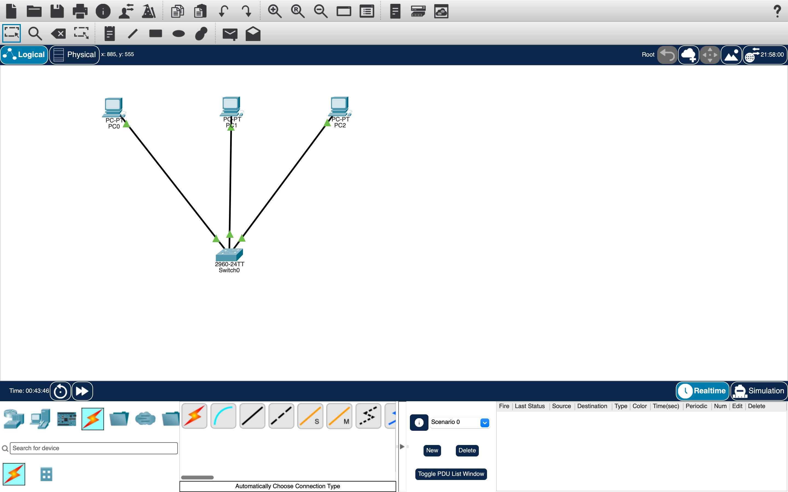
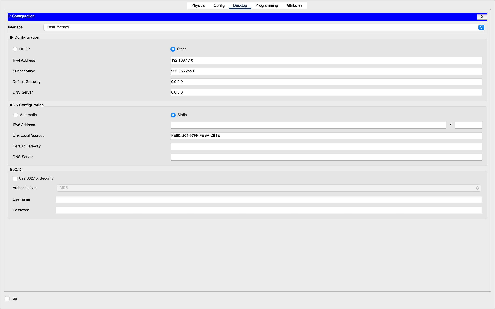
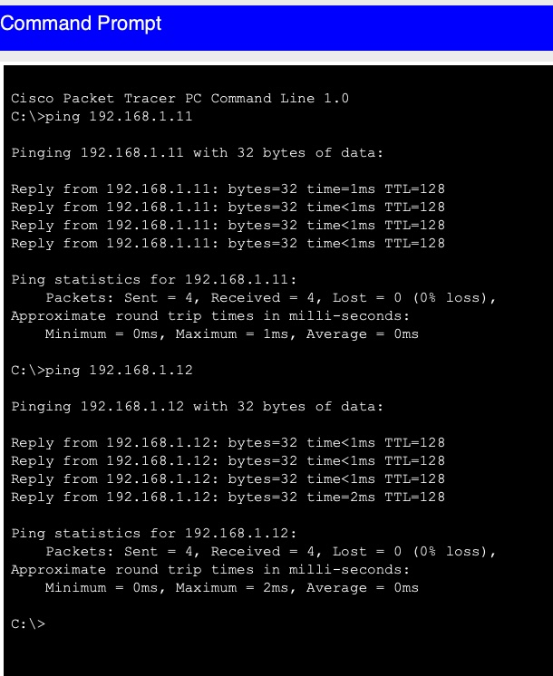
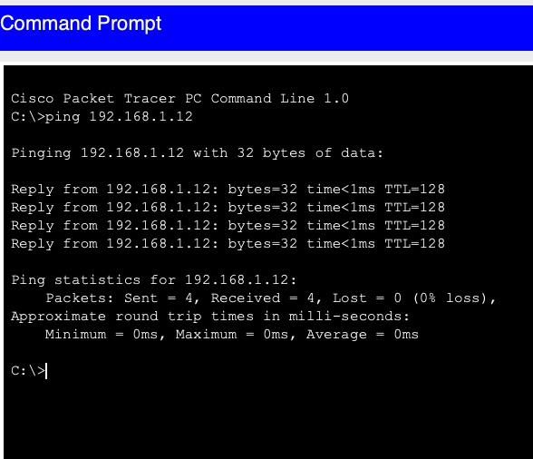
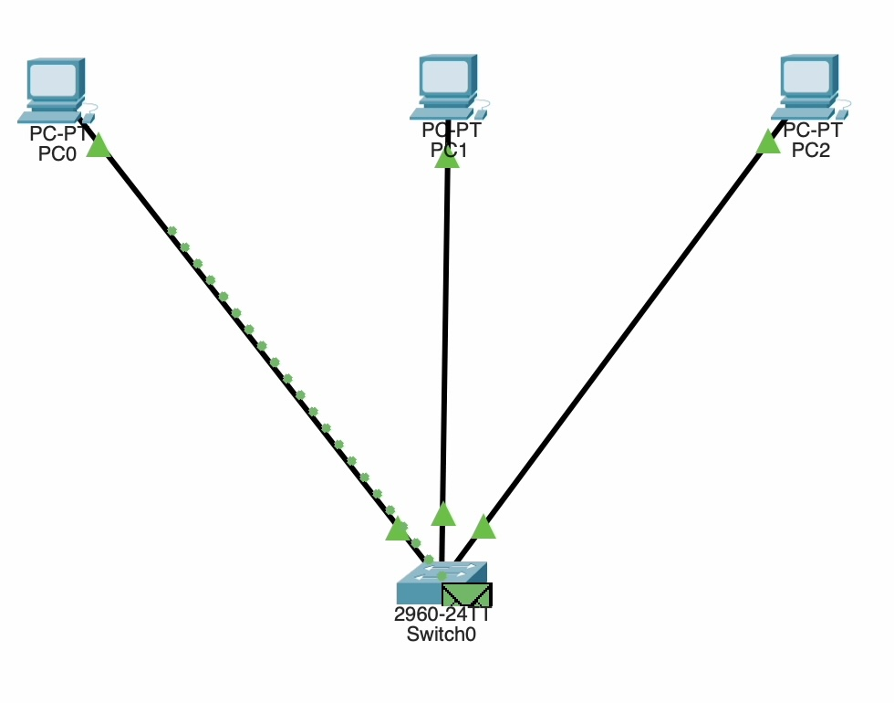
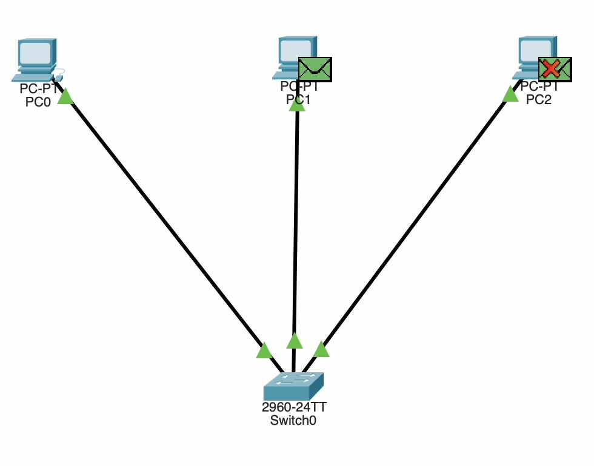

# Project 1: My First Office Network (Cisco Packet Tracer)

**What it's about:** A small office network built in Cisco Packet Tracer: three computers connected through one switch, all on the same network.

**What I built:**
- 3 PCs connected to a Cisco 2960 switch
- Gave each PC a static IP address on the same network (192.168.1.10, .11, and .12, with mask 255.255.255.0)
- Tested the connections with ping between every pair of PCs: 4 sent, 4 received, 0% loss each time
- Used Simulation mode to watch a message travel through the switch

**What I learned:**
- A switch connects devices on the same network and passes messages between them
- Computers on the same network share the same first three numbers (the network part) and differ in the last (the device part)
- A switch starts with an empty list of who is plugged into which port. On the first message it sends a copy out of every port, and the PCs it wasn't meant for ignore it. After that it learns and sends messages only to the right port
- Ping is a quick way to test that two devices can reach each other

**Tools used:** Cisco Packet Tracer, 2960 switch, command prompt (ping)

**Status:** Completed

## Screenshots

Network diagram:

IP configuration on PC0:

Ping tests from PC0 (0% loss):

Ping test from PC1 to PC2 (0% loss):

Simulation mode, message reaching the switch:

Simulation mode, PC1 accepts the message and PC2 drops its copy:

