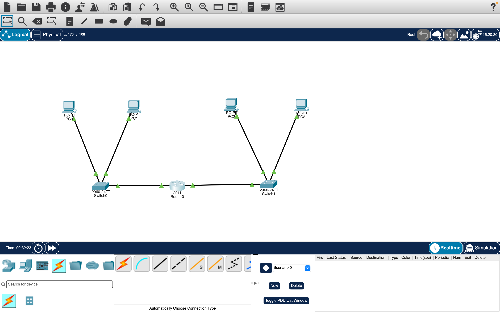
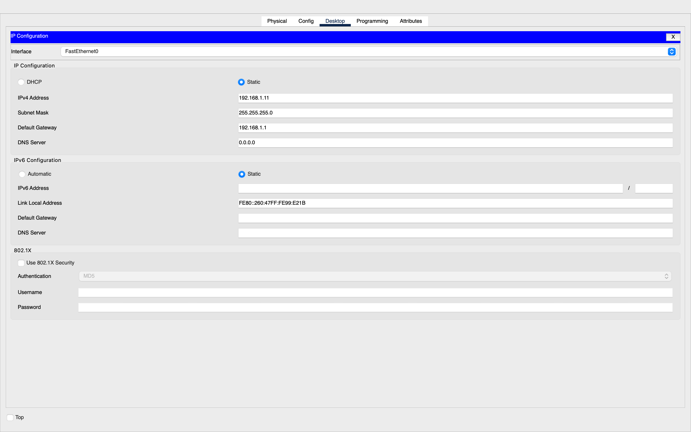
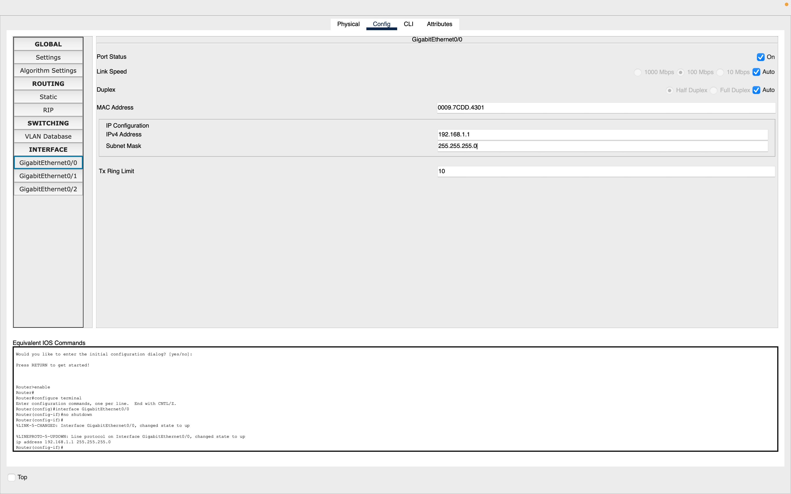
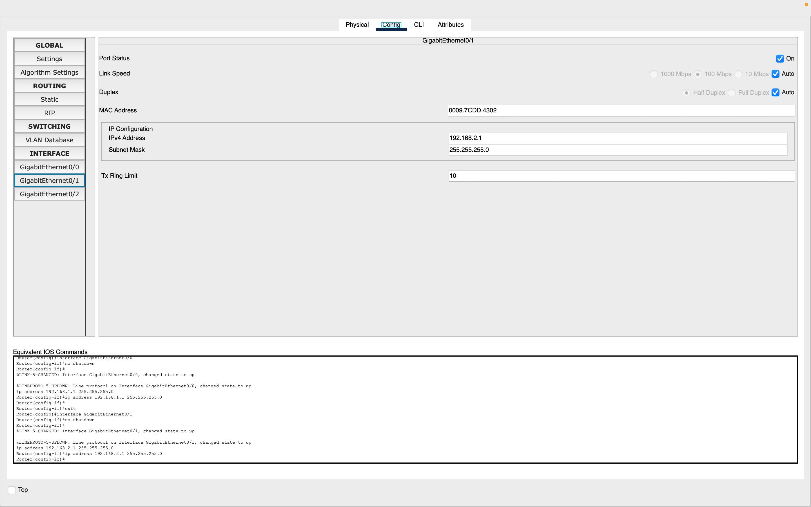
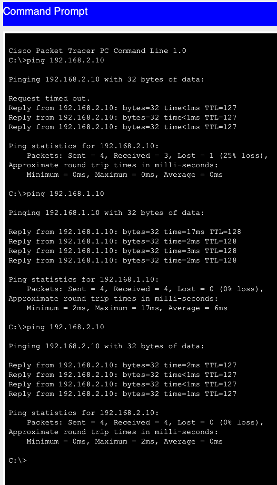

# Project 2: Two Departments Joined by a Router (Cisco Packet Tracer)

**What it's about:** A small office network with two departments (Admin and Staff), each on its own network, connected by a router so they can talk to each other.

**What I built:**
- 4 PCs, 2 switches, and 1 Cisco 2911 router
- Admin network 192.168.1.0 and Staff network 192.168.2.0, both with mask 255.255.255.0
- Switched on the router's two ports and gave each one an address (192.168.1.1 and 192.168.2.1). These act as the default gateway for each department
- Set each PC's default gateway to its own department's router address
- Tested with ping between the two departments

**What I learned:**
- Devices on different networks can't talk directly. They send traffic to their default gateway (the router), which passes it on to the other network
- A router's ports start switched off and need an address on each network they connect
- The first ping across networks often times out while the devices learn each other, and the rest succeed
- TTL shows how many routers a message crossed. Replies from the same network showed TTL 128, and replies from the other department showed TTL 127, because the message passed through one router

**Tools used:** Cisco Packet Tracer, 2960 switches, 2911 router, command prompt (ping)

**Status:** Completed

## Screenshots

Network diagram:

A PC's IP configuration (PC1, Admin network), with the default gateway set to the router's address:

Router interface for the Admin network:

Router interface for the Staff network:

Ping tests (the first ping across networks times out once, then 0% loss and TTL 127 through the router):

