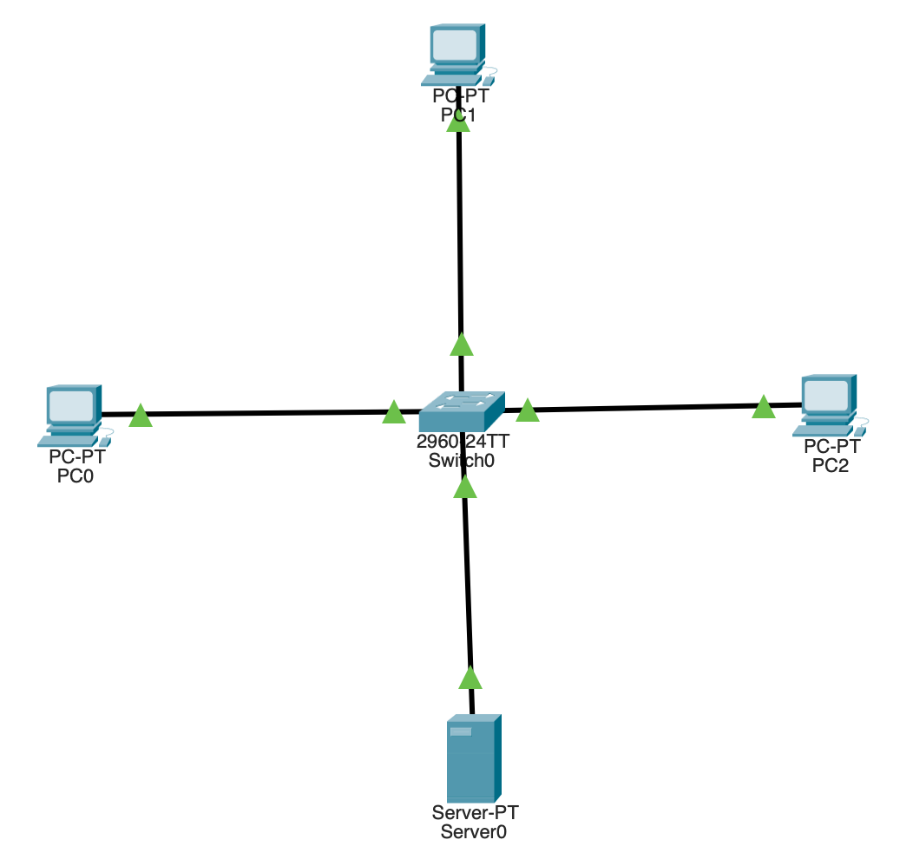
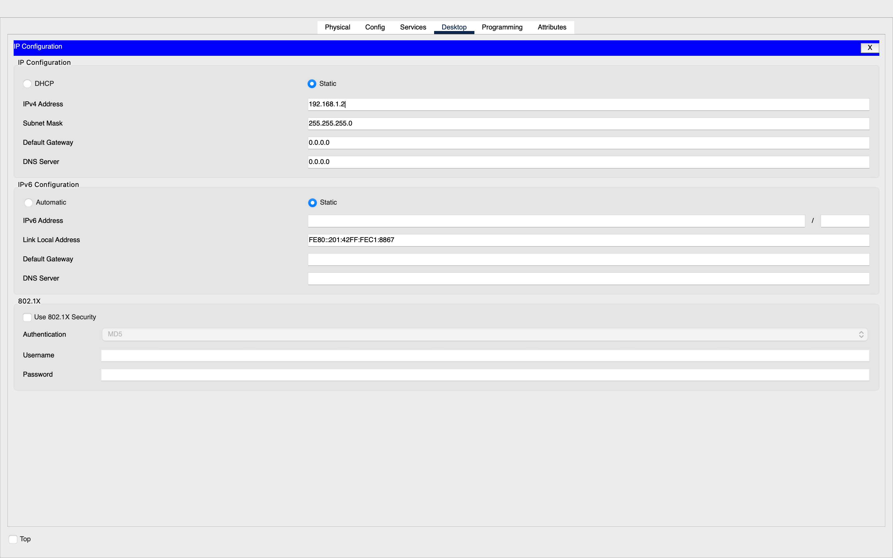
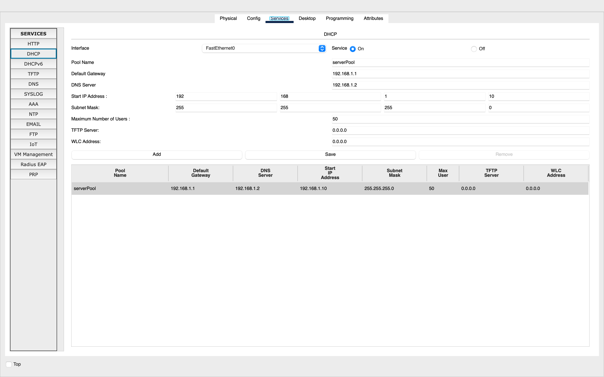
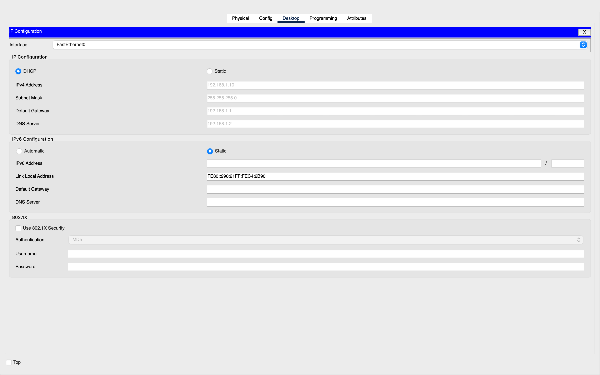
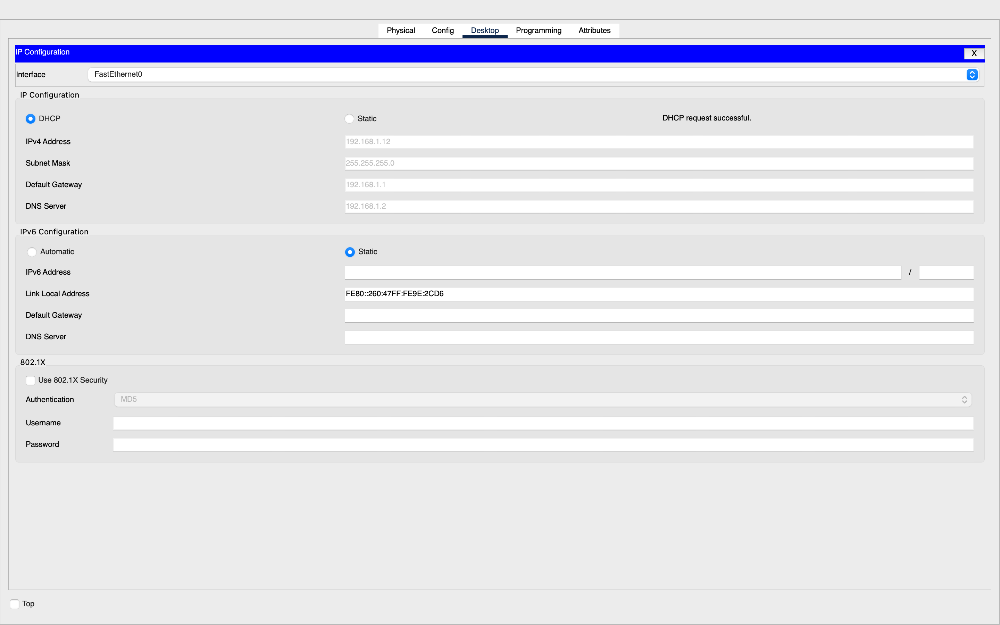
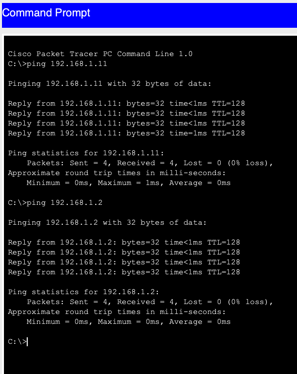

# Project 3: Automatic IP Addresses (DHCP)

## Goal
Set up a DHCP server so that computers on an office network receive their IP addresses automatically, instead of someone typing an address into every computer by hand.

## Real-world scenario
In a real office, a new employee plugs in a computer and it works straight away. A DHCP server on the network hands out the IP address, subnet mask, default gateway and DNS server. This saves time and avoids two computers being given the same address by mistake.

## Network design
- 1 switch (2960)
- 3 PCs (PC0, PC1, PC2)
- 1 server (Server0)
- Star layout: every device connects to the switch with a copper straight-through cable

## Addressing plan

| Device | Address | How it gets it |
|---|---|---|
| Server0 | 192.168.1.2 | Static (typed in) |
| PC0 | 192.168.1.10 | DHCP (automatic) |
| PC1 | 192.168.1.11 | DHCP (automatic) |
| PC2 | 192.168.1.12 | DHCP (automatic) |

Subnet mask for everything: 255.255.255.0 (/24)

The server uses a static address because other devices need to be able to find it. Everything else gets an address automatically.

## Steps

### 1. Build the network
I placed 3 PCs, 1 server and 1 switch, then connected each device to the switch using copper straight-through cables. All links turned green.

### 2. Give the server a static address
On Server0, under Desktop > IP Configuration, I set:
- IPv4 Address: 192.168.1.2
- Subnet Mask: 255.255.255.0

### 3. Set up the DHCP service
On Server0, under Services > DHCP, I created a pool with:
- Default Gateway: 192.168.1.1
- DNS Server: 192.168.1.2
- Start IP Address: 192.168.1.10
- Subnet Mask: 255.255.255.0
- Maximum number of users: 50

I saved the pool and switched the service to On.

### 4. Switch the PCs to DHCP
On each PC, under Desktop > IP Configuration, I selected DHCP. Each PC received its address from the server on its own.

## Testing
From PC0, I pinged PC1 (192.168.1.11) and the server (192.168.1.2). Both replied with 0% packet loss.

## Result
All three PCs received an IP address, subnet mask, default gateway and DNS server automatically, and could communicate with each other and the server.

## What I learned
- DHCP follows four steps called DORA: Discover, Offer, Request, Acknowledge.
- Servers get static addresses so they are always easy to find, while regular computers can use DHCP.
- The pool starts at .10 so that the addresses .1 to .9 stay free for important devices like routers and servers.
- A DHCP pool has a limit (here 50 addresses), so planning matters in a real network.

## Notes
- The default gateway (192.168.1.1) is included in the pool for a router that will be added in a later project. This network does not have a router yet, so the PCs can only talk to devices on the same network.
