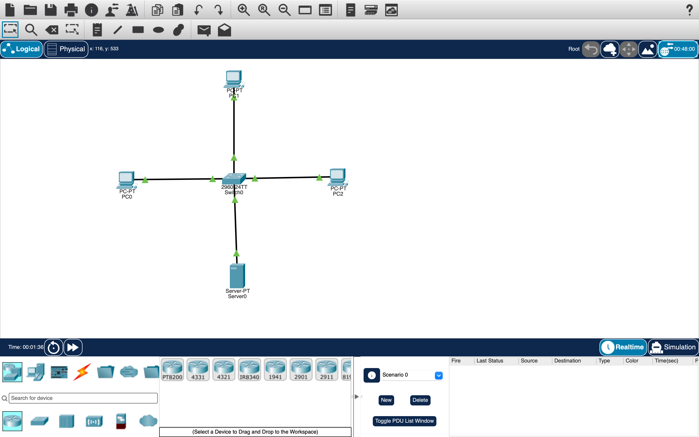
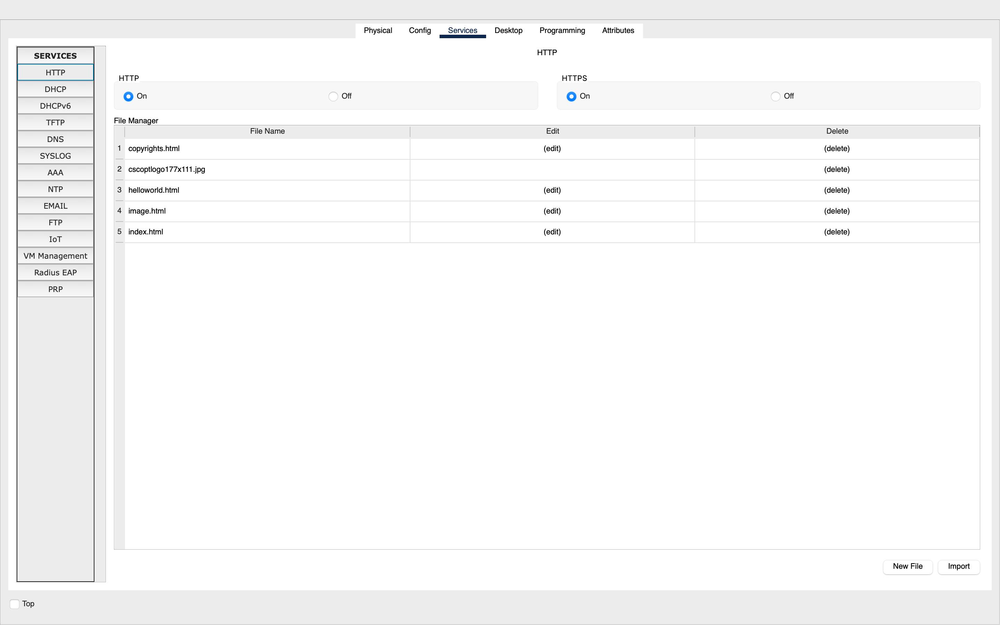
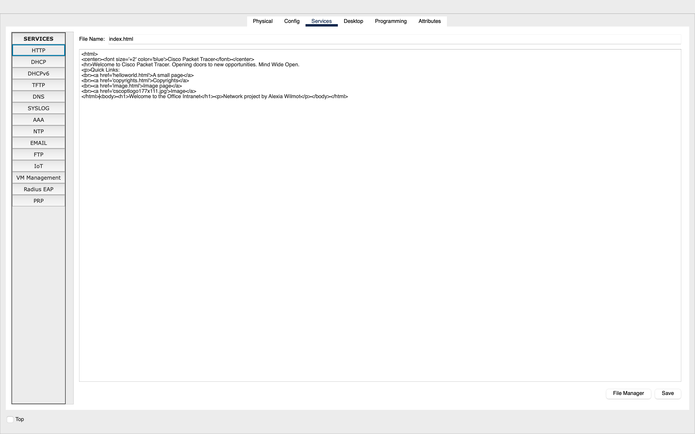
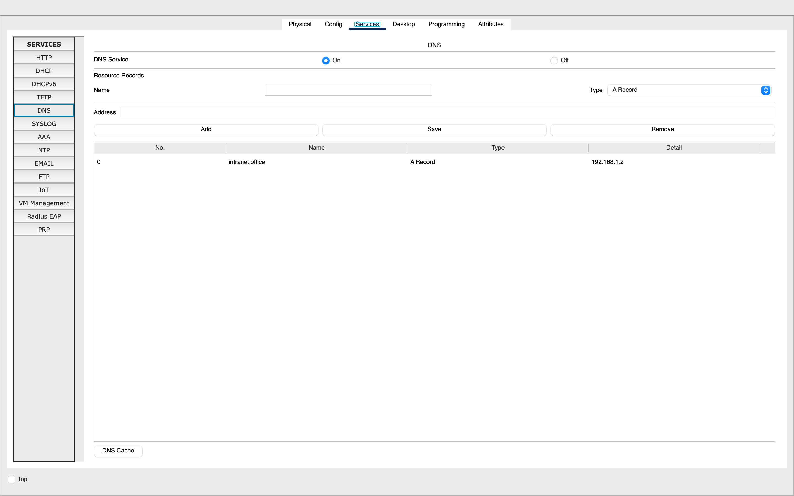
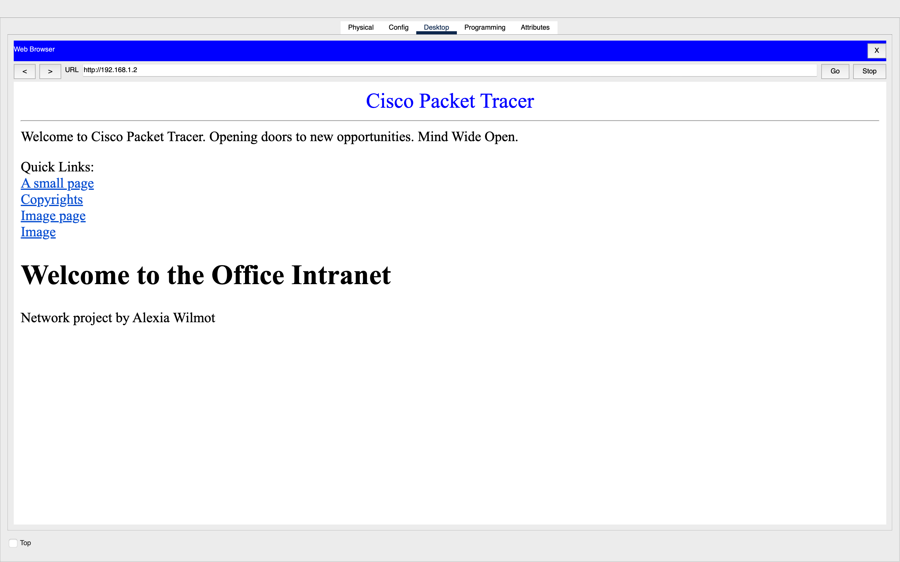
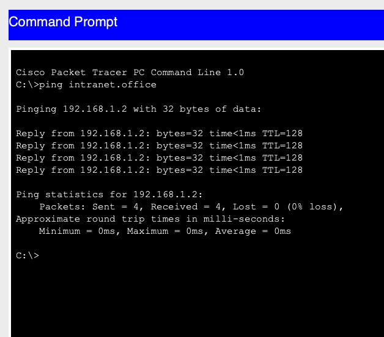

# Project 4: Websites by Name (DNS and Web Server)

## Goal
Set up a web server and a DNS server so that staff can open an internal company website by typing a name instead of an IP address.

## Real-world scenario
Nobody remembers numbers like 192.168.1.2. In a real office, employees type a name such as intranet.office to reach the company's internal website. A DNS server translates that name into the IP address, and a web server delivers the page.

## Network design
This project builds on Project 3. It uses the same network, with two more services turned on in the server.
- 1 switch (2960)
- 3 PCs (PC0, PC1, PC2), getting their addresses from DHCP
- 1 server (Server0, 192.168.1.2) running DHCP, HTTP (web) and DNS

## Addressing plan

| Device | Address |
|---|---|
| Server0 | 192.168.1.2 (static) |
| PC0 | 192.168.1.10 (DHCP) |
| PC1 | 192.168.1.11 (DHCP) |
| PC2 | 192.168.1.12 (DHCP) |

Website name: intranet.office, which points to 192.168.1.2

The PCs already knew where the DNS server was, because the DHCP server gave them 192.168.1.2 as their DNS server in Project 3.

## Steps

### 1. Turn on the web server
On Server0, under Services > HTTP, I made sure HTTP was On.

### 2. Change the welcome page
In the HTTP file manager, I edited index.html so that the page shows "Welcome to the Office Intranet".

### 3. Create the DNS record
On Server0, under Services > DNS, I turned the DNS service On and added an A record:
- Name: intranet.office
- Type: A Record
- Address: 192.168.1.2

## Testing

### Open the website by IP address
From PC0's web browser, I opened http://192.168.1.2 and the welcome page loaded.

### Open the website by name
I then opened http://intranet.office and got the same page. This shows that DNS translated the name into the IP address.

### Ping by name
From PC0's Command Prompt, I ran ping intranet.office. The reply came from 192.168.1.2 with 0% packet loss, which confirms the name was resolved to the correct address.

## Result
The internal website opens using the name intranet.office as well as the IP address.

## What I learned
- DNS works like a phone's contact list: you use the name, and DNS finds the number.
- An A record links a name to an IPv4 address.
- A web server and a DNS server can run on the same machine.
- DHCP can hand out the DNS server address, so clients are ready to use names without extra setup.
- If the IP address works but the name does not, the problem is usually DNS and not the network.
