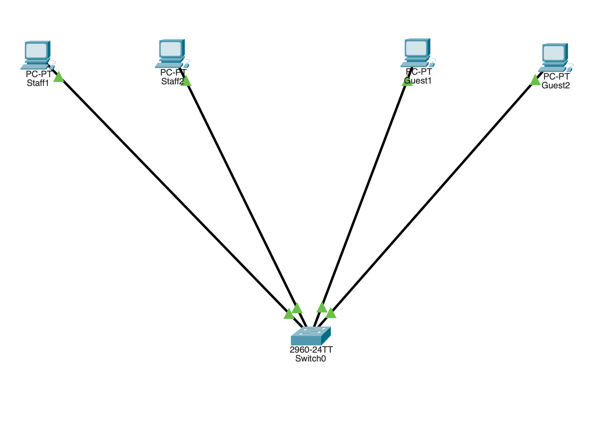
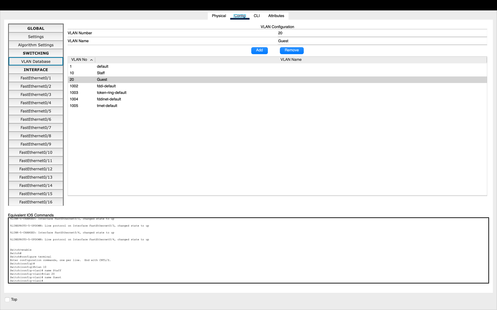
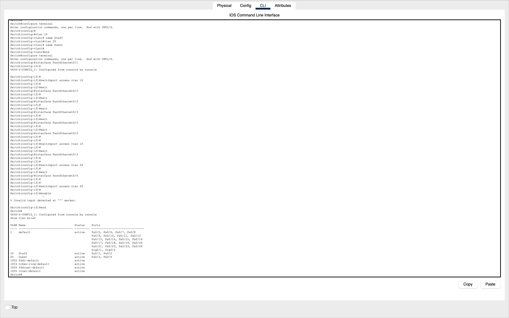
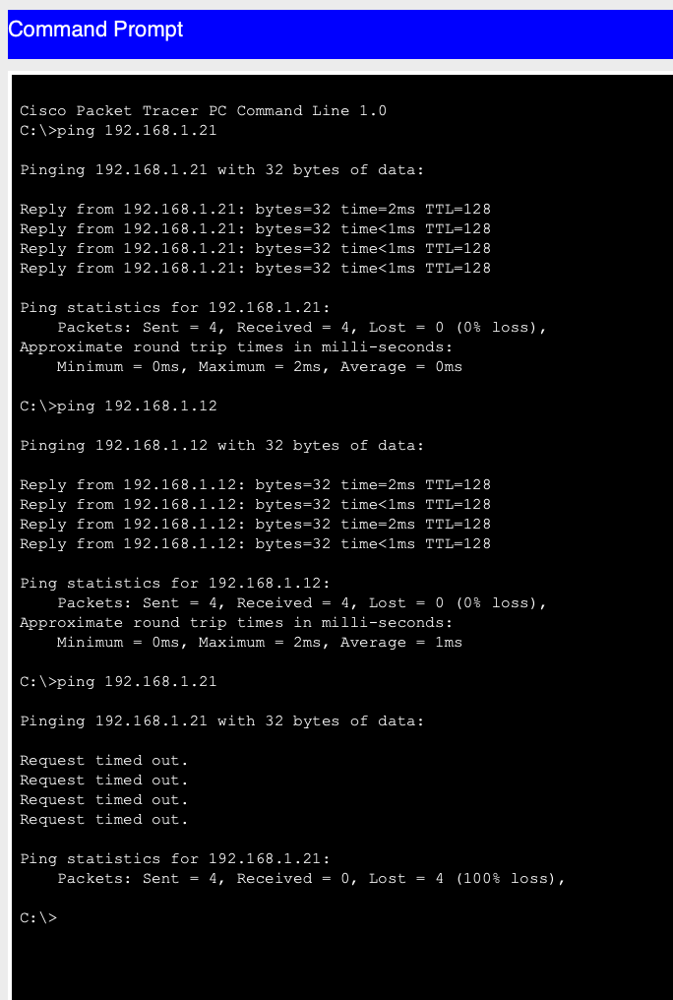

# Project 5: Separate Staff and Guests (VLANs)

## Goal
Use VLANs to split one switch into two separate networks, so that guest computers cannot reach staff computers.

## Real-world scenario
A hotel or office often has staff computers and guest computers connected to the same switch. Guests should not be able to reach staff machines. A VLAN divides the switch into separate "rooms", so devices in one VLAN cannot talk to devices in another, even though they share the same hardware.

## Network design
- 1 switch (2960)
- 2 staff PCs (Staff1, Staff2) in VLAN 10
- 2 guest PCs (Guest1, Guest2) in VLAN 20
- Each PC connects to the switch with a copper straight-through cable



## Addressing plan

| Device | IP Address | Subnet Mask | Switch Port | VLAN |
|---|---|---|---|---|
| Staff1 | 192.168.1.11 | 255.255.255.0 | Fa0/1 | 10 (Staff) |
| Staff2 | 192.168.1.12 | 255.255.255.0 | Fa0/2 | 10 (Staff) |
| Guest1 | 192.168.1.21 | 255.255.255.0 | Fa0/3 | 20 (Guest) |
| Guest2 | 192.168.1.22 | 255.255.255.0 | Fa0/4 | 20 (Guest) |

All four PCs were given static addresses in the same range, so that before the VLANs they could all reach each other.

## Steps

### 1. Test before the VLANs
Before changing the switch, I pinged Guest1 (192.168.1.21) from Staff1. The ping worked, which shows that a guest computer could reach a staff computer. This is the problem the VLANs solve.

### 2. Create the VLANs
On the switch, I created two VLANs:

```
vlan 10
 name Staff
vlan 20
 name Guest
```



### 3. Assign each port to a VLAN
Ports 1 and 2 (the staff PCs) went into VLAN 10, and ports 3 and 4 (the guest PCs) went into VLAN 20:

```
interface FastEthernet0/1
 switchport access vlan 10
interface FastEthernet0/2
 switchport access vlan 10
interface FastEthernet0/3
 switchport access vlan 20
interface FastEthernet0/4
 switchport access vlan 20
```

### 4. Check the VLANs
I used `show vlan brief` to confirm the ports were in the right VLANs: VLAN 10 Staff has Fa0/1 and Fa0/2, and VLAN 20 Guest has Fa0/3 and Fa0/4.



## Testing
From Staff1, I pinged:
- Guest1 (192.168.1.21) before the VLANs: worked
- Staff2 (192.168.1.12) after the VLANs: worked, because it is in the same VLAN
- Guest1 (192.168.1.21) after the VLANs: failed with 100% packet loss, because it is in a different VLAN



## Result
Staff computers can talk to each other, and guest computers can talk to each other, but staff and guests can no longer reach one another. The VLANs separated them on the same physical switch.

## What I learned
- A VLAN divides one switch into separate virtual networks.
- A port is placed in a VLAN with `switchport access vlan`.
- Devices in different VLANs cannot communicate unless a router is added between them.
- `show vlan brief` is a quick way to check which ports belong to which VLAN.
- Separating guests from staff is a basic security measure that reduces what an attacker on the guest network can reach.

## Notes
- This project uses a single switch and no router, so the separation is complete. In a bigger network, a router or Layer 3 switch could allow only certain traffic between VLANs.
