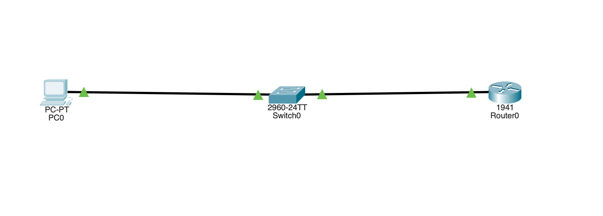
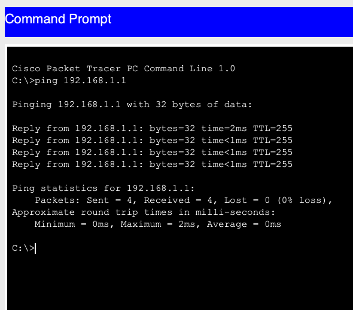
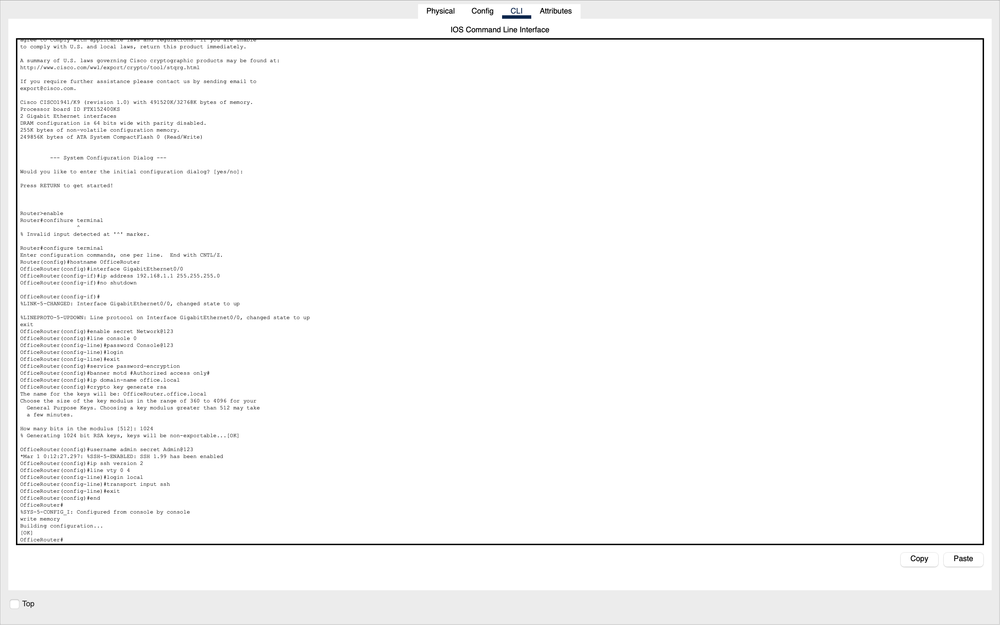
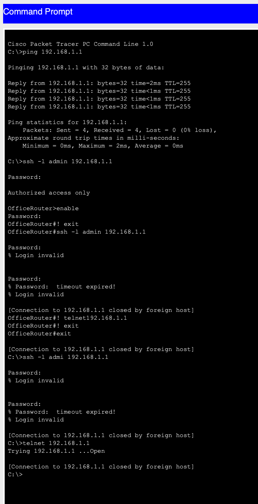
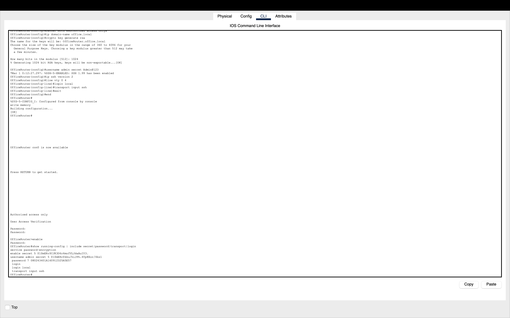

# Project 6: Securing an Office Router

## Goal
Lock down an office router so only authorized people can log in, passwords are hidden, and only secure remote access (SSH) is allowed.

## What I Built
- 1 router (OfficeRouter)
- 1 switch
- 1 PC connected to the switch
- Router IP address: 192.168.1.1

## What I Secured
| Setting | What it does |
|---|---|
| Hostname (OfficeRouter) | Gives the router a clear name |
| Enable secret | Password needed to enter admin mode (stored scrambled) |
| Console password | Protects the physical/console connection |
| service password-encryption | Scrambles saved passwords so they cannot be read |
| Login banner | Warns that only authorized users may log in |
| SSH (version 2) | Secure remote login with a username and password |
| Telnet disabled | Blocks the old, unsafe way of logging in remotely |
| write memory | Saves the settings so they stay after a restart |

## Main Commands Used
(Passwords are not shown here. These were practice passwords for this lab.)

    hostname OfficeRouter
    interface GigabitEthernet0/0
     ip address 192.168.1.1 255.255.255.0
     no shutdown
    enable secret <password>
    line console 0
     password <password>
     login
    service password-encryption
    banner motd #Authorized access only#
    ip domain-name office.local
    crypto key generate rsa
    username admin secret <password>
    ip ssh version 2
    line vty 0 4
     login local
     transport input ssh
    write memory

## Tests I Ran
1. **Ping the router from the PC:** 4 out of 4 replies, so the connection works.
2. **SSH with the correct login:** worked.
3. **SSH with a wrong username:** refused ("Login invalid").
4. **Telnet:** the connection was closed, so it is blocked.
5. **Config check:** passwords show as scrambled text, not plain words.

## Screenshots
**Topology**

**Ping test**

**Router commands**

**SSH and Telnet tests**

**Hidden passwords in the config**

## What I Learned
- Passwords should never be stored as plain text. `enable secret` and `service password-encryption` hide them.
- SSH encrypts the connection, but Telnet does not, so Telnet should be turned off.
- `login local` makes people use a username and password.
- Settings must be saved with `write memory` or they are lost on restart.
- Every router in a real office should be locked down like this.
